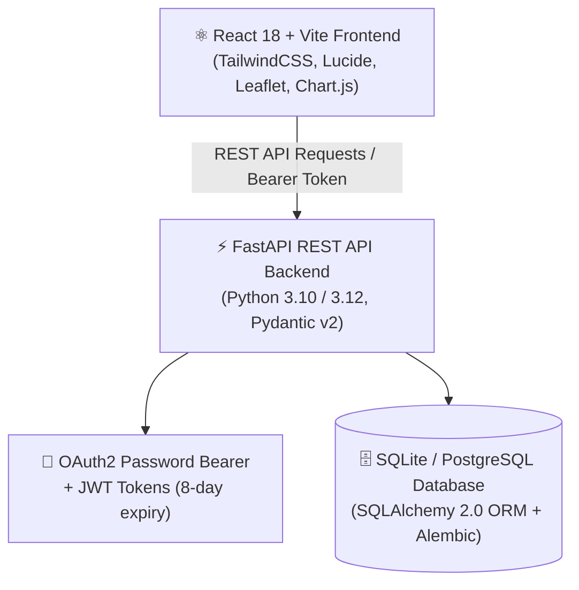
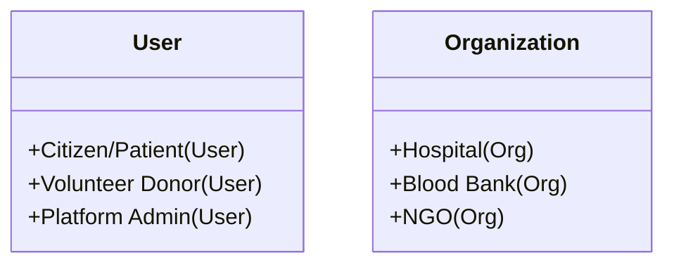
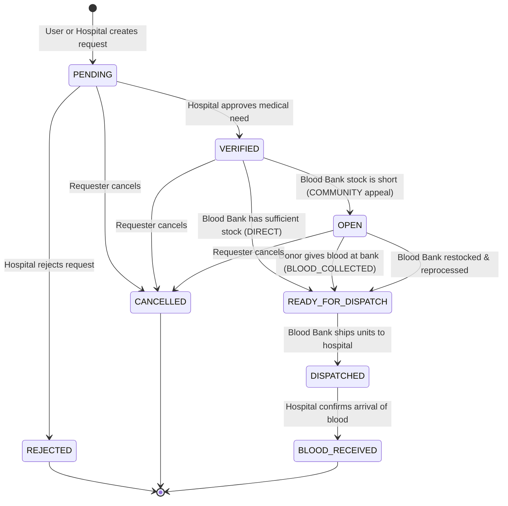
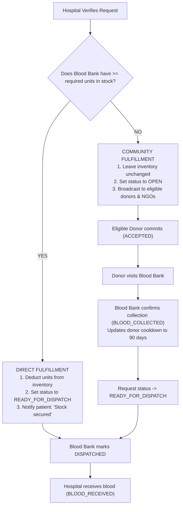
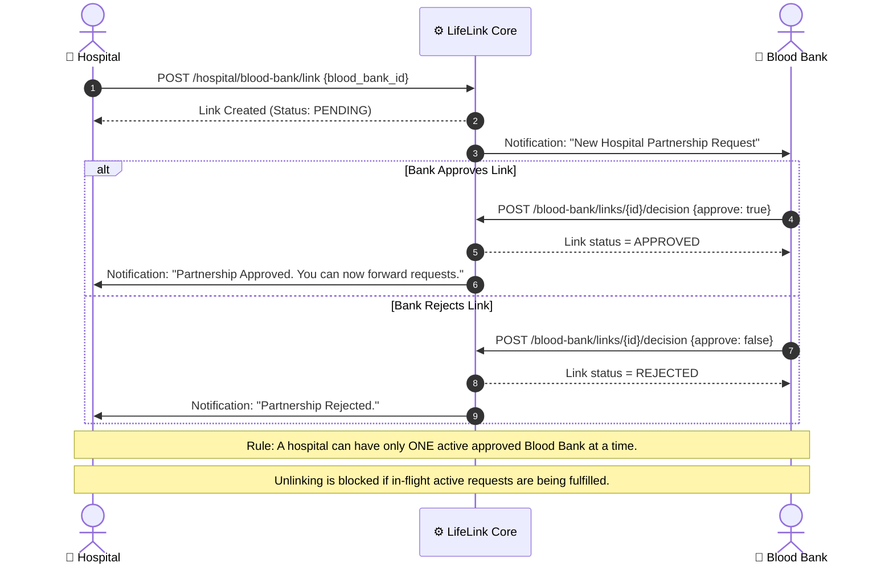
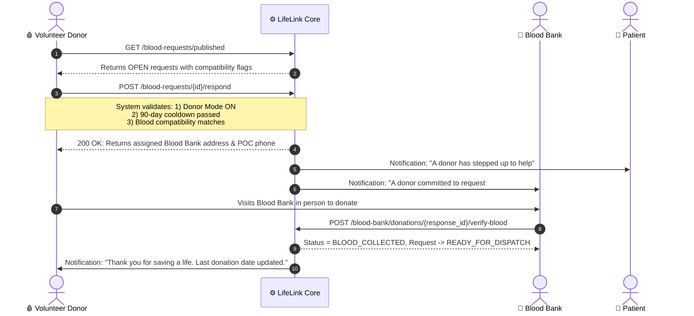
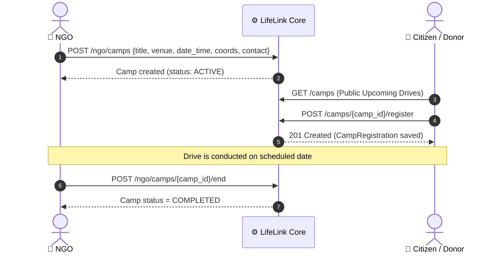
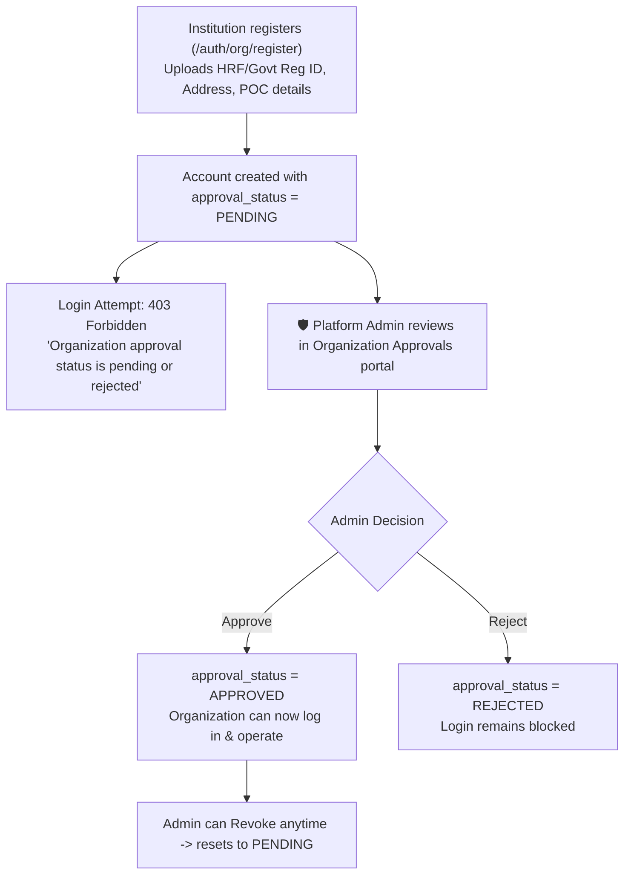
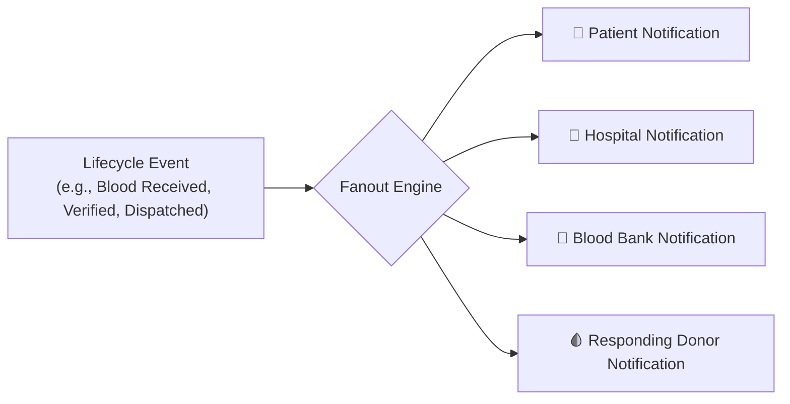
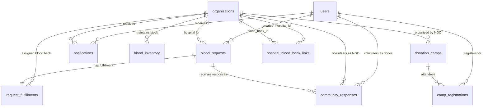

# 🩸 LifeLink: Comprehensive Application Architecture & Workflow Blueprint

> **Document Purpose:**  
> This master document outlines the complete operational flow, user roles, business lifecycles, database architecture, API endpoints, frontend views, and core logic of the **LifeLink** platform.  
> It is designed specifically as an architectural reference and decision checklist for project redesigns, feature simplification, or building a revamped next-generation system.

---

## 📑 Table of Contents
1. [Executive Summary & Concept](#1-executive-summary--concept)
2. [Technology Stack & Architecture](#2-technology-stack--architecture)
3. [The 6 Major User Roles & Their Capabilities](#3-the-6-major-user-roles--their-capabilities)
4. [Core Lifecycles & State Machines](#4-core-lifecycles--state-machines)
   - [4.1 The Core Blood Request Lifecycle](#41-the-core-blood-request-lifecycle)
   - [4.2 Blood Bank Inventory & Fulfillment Triage (Direct vs Community)](#42-blood-bank-inventory--fulfillment-triage-direct-vs-community)
   - [4.3 Hospital ↔ Blood Bank B2B Association Cycle](#43-hospital--blood-bank-b2b-association-cycle)
   - [4.4 Community Donor Response & Verification Cycle](#44-community-donor-response--verification-cycle)
   - [4.5 NGO Donation Camps / Blood Drives Lifecycle](#45-ngo-donation-camps--blood-drives-lifecycle)
   - [4.6 Institutional KYC & Organization Onboarding](#46-institutional-kyc--organization-onboarding)
   - [4.7 Multi-Party Automated Notification Fanout](#47-multi-party-automated-notification-fanout)
5. [Clinical Business Rules & Compatibility Matrix](#5-clinical-business-rules--compatibility-matrix)
6. [Database Schema & Data Dictionary (10 Models)](#6-database-schema--data-dictionary-10-models)
7. [Complete Backend REST API Directory](#7-complete-backend-rest-api-directory)
8. [Frontend Route & Screen Matrix](#8-frontend-route--screen-matrix)
9. [Complexity Assessment: Friction Points in Current Design](#9-complexity-assessment-friction-points-in-current-design)
10. [Redesign & Decision Worksheet (For You & Your Friend)](#10-redesign--decision-worksheet-for-you--your-friend)

---

## 1. Executive Summary & Concept

**LifeLink** is a specialized emergency healthcare coordination platform designed to eliminate delays and black markets in blood donation. In traditional settings, patients and families are forced to post frantic appeals on social media or search multiple blood banks during medical emergencies.

LifeLink coordinates all healthcare stakeholders into a single, closed-loop verified workflow:
- **Patients** create verified blood requests linked to an admitted hospital.
- **Hospitals** verify medical necessity to prevent fraud and order blood from approved blood banks.
- **Blood Banks** check live stock: if units exist, they dispatch immediately; if units are missing, they broadcast to volunteer donors.
- **Donors & NGOs** step up only when real shortages exist, donating directly at certified blood banks.
- **System Admin** enforces institutional KYC (verification) of hospitals, blood banks, and NGOs.

---

## 2. Technology Stack & Architecture

### Component Details
* **Backend:**
  - **Framework:** FastAPI with Python 3.12
  - **ORM & DB:** SQLAlchemy 2.0 with SQLite (`backend/healthcare.db`) and Alembic migrations
  - **Authentication:** OAuth2 Password Bearer with JWT access tokens (`HS256`, 8-day expiration)
  - **Validation:** Pydantic v2 schemas (`backend/schemas/`)
  - **State Integrity:** Strict transition assertions preventing out-of-order lifecycle jumps
* **Frontend:**
  - **Framework:** React 18 with Vite
  - **Routing:** React Router v7 (`BrowserRouter`, `ProtectedRoute` by role)
  - **Styling:** TailwindCSS 4 + custom design tokens
  - **Mapping & Charts:** Leaflet (interactive maps) & Chart.js (analytics dashboards)
  - **Icons:** Lucide React

---

## 3. The 6 Major User Roles & Their Capabilities

The platform defines two classes of accounts: **Individual Citizens** (`users` table) and **Institutions** (`organizations` table).

### 1. 👤 Regular User (Citizen / Patient / Requester)
* **Who they are:** A citizen, patient, or family member in need of blood.
* **Key capabilities:**
  - Create a new emergency blood request (`patient_name`, `blood_group`, `units_required`, `hospital_id`, `priority`, `emergency_reason`).
  - View real-time tracking timeline of their own blood requests (Pending → Verified → Dispatched → Received).
  - Cancel a blood request *before* it has been secured or dispatched.
  - Search and register for upcoming NGO blood donation drives/camps.
  - Receive automated notifications when the hospital verifies their request or when blood is dispatched.

### 2. 🩸 Volunteer Donor (Citizen with Donor Mode Active)
* **Who they are:** A registered citizen who turns on "Donor Mode".
* **Key capabilities:**
  - Toggle `donor_mode_enabled` on/off with one click.
  - Access the **Compatibility Matrix** to see which blood groups they can safely give to.
  - View **Published Requests** (`OPEN` requests that blood banks could not fulfill from stock).
  - Check donation eligibility (must observe a **90-day cooldown** between donations).
  - Commit to donate: clicking **"Respond"** creates a `CommunityResponse` record, sends driving/contact details for the assigned blood bank, and reserves a donation slot.
  - View personal **Donation History** and completed donations.

### 3. 🏥 Hospital Organization
* **Who they are:** Verified medical institution with admitted patients.
* **Key capabilities:**
  - **Link with Blood Banks:** Must request a B2B link with an approved blood bank before fulfilling requests.
  - **Verify Patient Requests:** Receive requests raised by patients admitted to their facility; doctor/admin reviews and approves (`VERIFIED`) or rejects (`REJECTED`).
  - **Raise Emergency Requests directly:** Hospital staff can raise requests directly for patients.
  - **Confirm Blood Received:** When blood arrives from the blood bank, hospital confirms receipt (`BLOOD_RECEIVED`), closing the entire loop and notifying the patient and all participating donors.
  - **Manage Links:** Can unlink from a blood bank once all pending in-flight requests are resolved.

### 4. 🏬 Blood Bank Organization
* **Who they are:** Certified blood storage, testing, and component collection facility.
* **Key capabilities:**
  - **Real-Time Inventory Management:** Maintain live stock count across all 8 blood groups (`A+`, `A-`, `B+`, `B-`, `AB+`, `AB-`, `O+`, `O-`).
  - **B2B Hospital Link Management:** Review and approve/reject linkage requests from partner hospitals.
  - **Automatic Stock Triage:** When a hospital-verified request arrives:
    - *If stock is sufficient:* System deducts stock, sets mode to `DIRECT`, and moves request to `READY_FOR_DISPATCH`.
    - *If stock is deficient:* Sets mode to `COMMUNITY`, moves request to `OPEN`, broadcasting it to nearby donors and NGOs.
  - **In-Person Donor Verification:** When a volunteer donor arrives at the bank to donate, staff clicks **"Verify Blood Collected"**, recording the donation, updating donor cooldown (`last_donation_date = today`), and advancing the request to `READY_FOR_DISPATCH`.
  - **Mark Dispatched:** Dispatch blood units in transit to the hospital (`DISPATCHED`).
  - **Stand Down Responders:** If stock becomes available after an open appeal, excess volunteers are automatically notified that donation is no longer needed.

### 5. 🤝 NGO (Non-Governmental Organization)
* **Who they are:** Community welfare foundation or blood charity.
* **Key capabilities:**
  - **Organize Blood Donation Camps:** Create and publish public blood donation camps (`title`, `venue`, `date_time`, coordinates, contact details).
  - **Manage Camp Registrations:** View list of citizens registered for upcoming camps; mark camps as `COMPLETED`.
  - **Mobilize for Emergency Requests:** View active `OPEN` emergency requests and volunteer on behalf of the organization.

### 6. 🛡️ System Administrator
* **Who they are:** Platform governance authority.
* **Key capabilities:**
  - **Institutional KYC Oversight:** View pending registrations for Hospitals, Blood Banks, and NGOs, inspect HRF/registration IDs, and approve or reject access.
  - **Access Revocation:** Temporarily revoke an organization's access back to pending status.
  - **Platform Analytics & Visual Charts:**
    - Donor blood group breakdown
    - Aggregated live blood stock across all blood banks
    - Request distribution by urgency (`EMERGENCY`, `URGENT`, `PLANNED`) and status
    - Hospital performance and fulfillment speed
  - **User & Organization Auditing:** Full search, inspection, and profile view of every user and facility.

---

## 4. Core Lifecycles & State Machines

### 4.1 The Core Blood Request Lifecycle

Every blood request moves through a strict, deterministic finite-state machine. Out-of-sequence transitions return `409 Conflict`.

#### Detailed Transition Rules:
| Current Status | Target Status | Triggering Actor | Pre-Conditions & Actions |
| :--- | :--- | :--- | :--- |
| **`PENDING`** | `VERIFIED` | 🏥 Hospital | Hospital must have an approved linked Blood Bank. |
| **`PENDING`** | `REJECTED` | 🏥 Hospital | Optional rejection reason logged and notified to user. |
| **`PENDING` / `VERIFIED` / `OPEN`** | `CANCELLED` | 👤 Requester | User cancels. Cannot cancel once status is `READY_FOR_DISPATCH` or later. |
| **`VERIFIED`** | `READY_FOR_DISPATCH` | 🏬 Blood Bank | Triggered via **Direct Fulfillment** if bank stock $\ge$ units requested. Stock is subtracted. |
| **`VERIFIED`** | `OPEN` | 🏬 Blood Bank | Triggered via **Community Fulfillment** if stock $<$ units requested. Public alert broadcasts. |
| **`OPEN`** | `READY_FOR_DISPATCH` | 🏬 Blood Bank | Volunteer visits bank; staff clicks "Verify Blood". Sets response to `BLOOD_COLLECTED`. |
| **`READY_FOR_DISPATCH`** | `DISPATCHED` | 🏬 Blood Bank | Units packaged and transit initiated to hospital. |
| **`DISPATCHED`** | `BLOOD_RECEIVED` | 🏥 Hospital | Blood reaches hospital. Terminal success state. Requester, bank, and donors notified. |

---

### 4.2 Blood Bank Inventory & Fulfillment Triage (Direct vs Community)

When a hospital verifies a patient's request, the blood bank initiates **Fulfillment Processing**:

---

### 4.3 Hospital ↔ Blood Bank B2B Association Cycle

To prevent chaos, a hospital does not arbitrarily source blood from random banks. It maintains a formal partnership:

---

### 4.4 Community Donor Response & Verification Cycle

When a request is published (`status = OPEN`):

---

### 4.5 NGO Donation Camps / Blood Drives Lifecycle

NGOs mobilize large community blood drives to replenish regional blood supplies:

---

### 4.6 Institutional KYC & Organization Onboarding

To prevent illegal blood trading or unlicensed actors:

---

### 4.7 Multi-Party Automated Notification Fanout

Whenever any state changes, `NotificationService` automatically generates alerts stored in the `notifications` table:

---

## 5. Clinical Business Rules & Compatibility Matrix

The backend enforces standard clinical whole-blood compatibility rules in [`blood_compatibility.py`](file:///Users/jashan/Documents/main%20PROJ/Software%20Engenering/MAY2026-Team-066/backend/services/blood_compatibility.py):

* **Universal Donor:** `O-` (can give to any blood group).
* **Universal Recipient:** `AB+` (can receive from any blood group).
* **Rh Factor Rule:** Rh-negative can donate to Rh-positive, but Rh-positive **cannot** donate to Rh-negative.

### Compatibility Table:
| Donor Group | Can Donate To (Recipients) |
| :--- | :--- |
| **O-** | `O-`, `O+`, `A-`, `A+`, `B-`, `B+`, `AB-`, `AB+` (All groups) |
| **O+** | `O+`, `A+`, `B+`, `AB+` |
| **A-** | `A-`, `A+`, `AB-`, `AB+` |
| **A+** | `A+`, `AB+` |
| **B-** | `B-`, `B+`, `AB-`, `AB+` |
| **B+** | `B+`, `AB+` |
| **AB-** | `AB-`, `AB+` |
| **AB+** | `AB+` (Only AB+) |

### Donor Eligibility Cooldown:
* **Cooldown Period:** **90 days** from `last_donation_date`.
* A donor who donated within the last 90 days cannot respond to an emergency request until the period has expired.

---

## 6. Database Schema & Data Dictionary (10 Models)

The database schema is defined in [`backend/core/models.py`](file:///Users/jashan/Documents/main%20PROJ/Software%20Engenering/MAY2026-Team-066/backend/core/models.py):

### Table Breakdown:

#### 1. `users`
* `id` (PK, Integer)
* `full_name` (String)
* `dob` (Date)
* `blood_group` (String: A+, A-, B+, etc.)
* `phone_number` (String)
* `email` (String, Unique)
* `address` (Text)
* `password_hash` (String, bcrypt)
* `aadhaar_number_redacted` (String)
* `donor_mode_enabled` (Boolean, default False)
* `last_donation_date` (Date, nullable)
* `current_lat`, `current_lng` (Numeric)
* `role` (String: "user", "admin")
* `created_at` (DateTime)

#### 2. `organizations`
* `id` (PK, Integer)
* `org_name` (String)
* `org_type` (String: "HOSPITAL", "BLOOD_BANK", "NGO")
* `poc_name` (String - Point of Contact)
* `poc_contact` (String)
* `email` (String, Unique)
* `registration_number_hrf_id` (String, Unique)
* `address` (Text)
* `supporting_docs_url` (String, nullable)
* `latitude`, `longitude` (Numeric, nullable)
* `approval_status` (String: "PENDING", "APPROVED", "REJECTED")
* `password_hash` (String)
* `created_at` (DateTime)

#### 3. `hospital_blood_bank_links`
* `id` (PK, Integer)
* `hospital_id` (FK -> `organizations.id`)
* `blood_bank_id` (FK -> `organizations.id`)
* `status` (String: "PENDING", "APPROVED", "REJECTED", "UNLINKED")
* `updated_at` (DateTime)
* *Constraint:* Unique on `(hospital_id, blood_bank_id)`.

#### 4. `blood_requests`
* `id` (PK, Integer)
* `requester_id` (FK -> `users.id`)
* `patient_name` (String)
* `blood_group_required` (String)
* `units_required` (Integer)
* `hospital_id` (FK -> `organizations.id`)
* `priority` (String: "EMERGENCY", "URGENT", "PLANNED")
* `emergency_reason` (Text, nullable)
* `status` (String: "PENDING", "VERIFIED", "OPEN", "READY_FOR_DISPATCH", "DISPATCHED", "BLOOD_RECEIVED", "REJECTED", "CANCELLED")
* `created_at` (DateTime)

#### 5. `request_fulfillments`
* `id` (PK, Integer)
* `request_id` (FK -> `blood_requests.id`, Unique)
* `fulfillment_type` (String: "DIRECT", "COMMUNITY")
* `assigned_blood_bank_id` (FK -> `organizations.id`, nullable)
* `updated_at` (DateTime)

#### 6. `blood_inventory`
* `id` (PK, Integer)
* `blood_bank_id` (FK -> `organizations.id`)
* `blood_group` (String)
* `units_available` (Integer, default 0)
* `updated_at` (DateTime)
* *Constraint:* Unique on `(blood_bank_id, blood_group)`.

#### 7. `community_responses`
* `id` (PK, Integer)
* `request_id` (FK -> `blood_requests.id`)
* `responder_type` (String: "DONOR", "NGO")
* `donor_id` (FK -> `users.id`, nullable)
* `ngo_id` (FK -> `organizations.id`, nullable)
* `status` (String: "ACCEPTED", "BLOOD_COLLECTED", "NOT_NEEDED")
* `timestamp` (DateTime)

#### 8. `donation_camps`
* `id` (PK, Integer)
* `ngo_id` (FK -> `organizations.id`)
* `title` (String)
* `venue` (Text)
* `date_time` (DateTime)
* `contact_info` (String)
* `latitude`, `longitude` (Numeric, nullable)
* `status` (String: "ACTIVE", "COMPLETED")
* `created_at` (DateTime)

#### 9. `camp_registrations`
* `id` (PK, Integer)
* `camp_id` (FK -> `donation_camps.id`)
* `user_id` (FK -> `users.id`)
* `registered_at` (DateTime)

#### 10. `notifications`
* `id` (PK, Integer)
* `recipient_user_id` (FK -> `users.id`, nullable)
* `recipient_org_id` (FK -> `organizations.id`, nullable)
* `title` (String)
* `message` (Text)
* `is_read` (Boolean, default False)
* `created_at` (DateTime)

---

## 7. Complete Backend REST API Directory

Base Prefix: `/api/v1`

### 🔑 Authentication (`/auth`)
* `POST /auth/register` — Register a citizen user.
* `POST /auth/login` — Login user/admin with email or phone + password.
* `POST /auth/org/register` — Register an organization (Hospital, Blood Bank, NGO).
* `POST /auth/org/login` — Login organization (must be `APPROVED`).
* `GET /auth/hospitals` — Public list of approved hospitals (for dropdowns).

### 👤 Citizen & Donor Management (`/users`)
* `GET /users/me` — Get current logged-in user profile.
* `PUT /users/me` — Update personal profile details.
* `PATCH /users/me/donor-mode` — Toggle donor availability (`true`/`false`).
* `PATCH /users/me/location` — Update user's geolocation coordinates.
* `GET /users/me/donation-history` — View user's past donations.
* `GET /users/me/response-statuses` — Check requests this user has already responded to.
* `GET /users/sos` — Find nearby emergency requests within ~50km.

### 🩸 Blood Requests (`/blood-requests`)
* `POST /blood-requests` — Citizen creates a blood request (status = `PENDING`).
* `GET /blood-requests/my` — List all requests created by the current user.
* `GET /blood-requests/published` — List `OPEN` community requests for donors.
* `GET /blood-requests/{id}` — Get request details and fulfillment status.
* `POST /blood-requests/{id}/cancel` — Cancel a request (before dispatch).
* `POST /blood-requests/{id}/respond` — Donor commits to an `OPEN` request.

### 🏥 Hospital Portal (`/hospital`)
* `GET /hospital/blood-bank` — Get hospital's currently approved linked blood bank.
* `GET /hospital/blood-bank/links` — List all link records (pending, approved, rejected).
* `POST /hospital/blood-bank/link` — Request partnership with a blood bank.
* `POST /hospital/blood-bank/unlink` — Dissolve current blood bank link.
* `GET /hospital/approved-blood-banks` — Search blood banks available for linking.
* `GET /hospital/requests` — List patient requests directed to this hospital.
* `GET /hospital/requests/{id}` — View single request details.
* `POST /hospital/requests` — Hospital raises blood request for a patient.
* `POST /hospital/requests/{id}/verify` — Approve (`VERIFIED`) or reject request.
* `POST /hospital/requests/{id}/confirm-received` — Mark request `BLOOD_RECEIVED`.

### 🏬 Blood Bank Portal (`/blood-bank`)
* `GET /blood-bank/inventory` — Get stock levels for all 8 blood groups.
* `PUT /blood-bank/inventory` — Update stock for a single blood group.
* `PUT /blood-bank/inventory/batch` — Bulk update stock for multiple blood groups.
* `GET /blood-bank/requests` — List incoming hospital-verified requests.
* `GET /blood-bank/requests/{id}` — View details of a specific request.
* `POST /blood-bank/requests/{id}/process` — Run stock triage (Direct vs Community).
* `POST /blood-bank/requests/{id}/dispatch` — Mark request `DISPATCHED`.
* `GET /blood-bank/links/pending` — List pending partnership requests from hospitals.
* `POST /blood-bank/links/{id}/decision` — Approve or reject hospital link request.
* `GET /blood-bank/hospitals` — List all linked hospitals.
* `GET /blood-bank/responses` — List donor and NGO commitments.
* `POST /blood-bank/donations/{response_id}/verify-blood` — Confirm physical blood collection.
* `GET /blood-bank/donations/logs` — List all completed blood collections.

### 🤝 NGO Portal (`/ngo`)
* `POST /ngo/camps` — Publish a new donation camp.
* `GET /ngo/camps` — List camps organized by this NGO.
* `GET /ngo/camps/{id}` — Get single camp details.
* `DELETE /ngo/camps/{id}` — Cancel/delete a camp.
* `POST /ngo/camps/{id}/end` — Mark camp as `COMPLETED`.
* `GET /ngo/requests` — View active `OPEN` requests.
* `POST /ngo/requests/{id}/respond` — Volunteer organization assistance for a request.
* `GET /ngo/my-responses` — List requests the NGO has committed to.

### ⛺ Public Camps (`/camps`)
* `GET /camps` — List upcoming public donation drives.
* `GET /camps/my-registrations` — View camps current user registered for.
* `POST /camps/{id}/register` — Register citizen to attend a camp.

### 🔔 Notifications (`/notifications`)
* `GET /notifications` — Get user or organization notifications.
* `PATCH /notifications/{id}/read` — Mark notification as read.
* `PATCH /notifications/read-all` — Mark all notifications as read.

### 🛡️ Platform Admin (`/admin`)
* `GET /admin/orgs/pending` — List organizations awaiting KYC verification.
* `GET /admin/orgs/active` — List approved organizations.
* `POST /admin/orgs/{id}/decision` — Approve or reject organization registration.
* `POST /admin/orgs/{id}/revoke` — Revoke organization access.
* `GET /admin/users` — Paginated list of all users.
* `GET /admin/users/{id}` — Inspect specific user details.
* `GET /admin/stats` — Platform summary KPI counts.
* `GET /admin/analytics` — Detailed analytics (blood distribution, inventory aggregates, request funnels).
* `GET /admin/reports/hospitals` — Hospital response speed & verification performance.
* `GET /admin/reports/blood-banks` — Blood bank inventory and dispatch performance.

---

## 8. Frontend Route & Screen Matrix

The React frontend has 38 dedicated routes organized by role:

| Route Path | Role Required | Screen Name & Description |
| :--- | :--- | :--- |
| `/` | Public | **Landing Page:** Hero showcase, mission statement, quick CTA buttons. |
| `/login` | Public | **Unified Login:** Auto-routes users and orgs to their respective dashboard. |
| `/register` | Public | **Register Portal:** Citizen and institutional registration tabs. |
| `/dashboard` | User / Admin | **Citizen Dashboard:** Live alerts, compatibility matrix, donor switch, quick stats. |
| `/request-blood` | User / Admin | **Emergency Blood Request Form:** Multi-step wizard to create a request. |
| `/my-requests` | User / Admin | **My Requests:** Table of user's requests with status badges. |
| `/my-requests/:id`| User / Admin | **Request Timeline Detail:** Visual 4-stage stepper tracking live progress. |
| `/published-requests`| User / Admin | **Community Appeals:** Open appeals with one-click "Respond to Donate" button. |
| `/donation-history`| User / Admin | **Donation History:** Personal log of blood donated and certificates/badges. |
| `/notifications` | User / Admin | **Notifications Center:** Inbox with unread count and read-all actions. |
| `/profile` | User / Admin | **User Profile:** Manage personal info, emergency contacts, blood group. |
| `/hospital/dashboard` | Hospital | **Hospital Overview:** Urgent requests awaiting doctor review, active orders. |
| `/hospital/requests/pending` | Hospital | **Pending Patient Requests:** Incoming patient requests requiring verification. |
| `/hospital/requests/review` | Hospital | **Review Modal/Page:** Clinical approval/rejection with reason input. |
| `/hospital/blood-bank` | Hospital | **Linked Blood Bank:** View current partner bank, search banks, send link request. |
| `/hospital/requests/confirm-received` | Hospital | **Delivery Receipt:** Confirm arrival of dispatched blood units. |
| `/hospital/requests/history` | Hospital | **Requisition History:** Archive of all past hospital blood orders. |
| `/bloodbank/dashboard` | Blood Bank | **Blood Bank Overview:** Critical stock alerts, hospital requisitions queue. |
| `/bloodbank/inventory` | Blood Bank | **Live Inventory Manager:** Interactive counters for all 8 blood component groups. |
| `/bloodbank/requests` | Blood Bank | **Incoming Orders:** Process orders via stock triage (Direct vs Community). |
| `/bloodbank/requests/tracking` | Blood Bank | **Order Dispatch Tracking:** Advance orders from Ready to Dispatched. |
| `/bloodbank/donations/verify` | Blood Bank | **Donor Verification Desk:** Check in volunteer donors and mark blood collected. |
| `/bloodbank/donations` | Blood Bank | **Donation Logs:** Record of every unit collected on-site. |
| `/bloodbank/hospitals` | Blood Bank | **Linked Hospitals:** Partner hospitals currently serviced. |
| `/bloodbank/hospitals/pending` | Blood Bank | **Link Requests:** Approve or reject hospital linkage requests. |
| `/bloodbank/camps` | Blood Bank | **Community Camps Feed:** View regional donation drives. |
| `/ngo/dashboard` | NGO | **NGO Command Center:** Active drives, emergency requests needing support. |
| `/ngo/drives` | NGO | **Drive Management:** Active and completed community blood donation camps. |
| `/ngo/drives/publish` | NGO | **Publish Drive:** Create camp with venue, date, map coordinates. |
| `/ngo/requests` | NGO | **Active Blood Requests:** Search emergency blood shortages across hospitals. |
| `/ngo/my-responses` | NGO | **My Commitments:** Volunteer responses coordinated by this NGO. |
| `/admin/dashboard` | Admin | **Admin Command Center:** System KPIs, high-level metrics, pending KYC badges. |
| `/admin/approvals/organizations` | Admin | **KYC Verification:** Approve or reject hospital/blood bank/NGO registrations. |
| `/admin/analytics` | Admin | **Platform Analytics:** Chart.js charts for blood groups, stock, urgency distribution. |
| `/admin/reports` | Admin | **Performance Reports:** Hospital delivery speed, blood bank inventory health. |
| `/admin/users` | Admin | **User Management:** Search and inspect citizen and donor accounts. |

---

## 9. Complexity Assessment: Friction Points in Current Design

If you and your friend are planning to rebuild, streamline, or create a brand new app, here are the **key sources of friction and complexity** in the current implementation:

### ⚠️ Complexity 1: Strict Multi-Party Dependency Chain
* **How it currently works:** A patient creates a request $\rightarrow$ Hospital MUST verify it $\rightarrow$ Hospital MUST have a pre-approved linked Blood Bank $\rightarrow$ Blood Bank MUST review stock $\rightarrow$ Blood Bank dispatches or publishes.
* **The Problem:** If a hospital forgets to link to a blood bank, **no patient request can be verified**. If a blood bank takes hours to check stock, the request is stalled.
* **Simplification Idea:** Allow patients to request blood directly from any nearby blood bank or donor pool without requiring hospital pre-approval, OR auto-route to the nearest blood bank based on GPS coordinates.

### ⚠️ Complexity 2: 1-to-1 Hospital-to-Blood Bank Locking
* **How it currently works:** A hospital can only link to **exactly one** blood bank at a time. If that blood bank runs out of blood, the hospital cannot order from another bank without unlinking first.
* **Simplification Idea:** Allow hospitals to broadcast or requisition from **any** approved blood bank with available stock, or have a shared unified regional blood inventory pool.

### ⚠️ Complexity 3: Two Distinct Database User Tables
* **How it currently works:** `users` (citizens/donors/admins) and `organizations` (hospitals/banks/NGOs) are completely separate tables with separate login endpoints (`/auth/login` vs `/auth/org/login`).
* **The Problem:** Requires double-checking role logic everywhere, dual auth handlers in frontend, and complex foreign key relationships in `CommunityResponse` and `Notification`.
* **Simplification Idea:** Merge into a single unified `accounts` table with an `account_type` or `role` enum (`PATIENT`, `DONOR`, `HOSPITAL`, `BLOOD_BANK`, `NGO`, `ADMIN`).

### ⚠️ Complexity 4: Manual In-Person Blood Verification Step
* **How it currently works:** When a donor volunteers, the request stays in limbo until the donor physically walks into the specific blood bank and a staff member manually finds the response ID and clicks "Verify Blood".
* **Simplification Idea:** Use a simple digital OTP or QR code that the donor shows at the collection center, or allow quick status confirmation via mobile.

### ⚠️ Complexity 5: 6 Different Roles May Be Overkill for an MVP
* **How it currently works:** You have to build and maintain 6 separate portals and layouts (Citizen, Donor, Hospital, Blood Bank, NGO, Admin).
* **Simplification Idea:** You could reduce the core app to just **3 primary roles**:
  1. **Requester / Patient** (Needs blood)
  2. **Donor** (Gives blood)
  3. **Healthcare Facility / Blood Center** (Manages inventory & verifies donation)

---

## 10. Redesign & Decision Worksheet (For You & Your Friend)

Use this table to review the current features with your friend. Check whether you want to **Keep**, **Simplify/Remove**, or **Add New**:

| Component / Feature | Current Implementation | Decision (Keep / Cut / Modify) | Your Notes & Next Steps |
| :--- | :--- | :---: | :--- |
| **User Roles** | 6 roles (User, Donor, Hospital, Blood Bank, NGO, Admin) | `[ ] Keep  [ ] Simplify` | |
| **Account Model** | Split `users` and `organizations` tables | `[ ] Keep  [ ] Merge` | |
| **Hospital Verification** | Every request must be verified by hospital doctor | `[ ] Keep  [ ] Remove` | |
| **Hospital-Bank Linking**| Strict 1-to-1 B2B partnership requirement | `[ ] Keep  [ ] Remove` | |
| **Blood Stock Triage** | Automated Direct vs Community fallback | `[ ] Keep  [ ] Simplify` | |
| **Compatibility Matrix** | Clinical whole-blood matching algorithm | `[ ] Keep  [ ] Enhance` | |
| **90-Day Donor Cooldown**| Blocks donations within 90 days of last date | `[ ] Keep  [ ] Modify` | |
| **Geolocation / Maps** | Leaflet maps + 50km bounding box for SOS | `[ ] Keep  [ ] Enhance` | |
| **Donation Camps (NGO)**| Separate camp creation and attendee registration | `[ ] Keep  [ ] Remove` | |
| **KYC Approvals** | Admin must approve all institutions before login | `[ ] Keep  [ ] Simplify` | |
| **In-App Notifications** | Persistent database notification fanout | `[ ] Keep  [ ] Push/SMS`| |

### 🚀 Candidate New Features to Consider for the Revamp:
1. **SMS / WhatsApp / Push Notifications:** Instant WhatsApp message to matching O-negative donors when a critical trauma case arrives.
2. **Real-Time GPS Live Tracking:** Uber-like live map tracking when blood is dispatched from a blood bank to a hospital.
3. **QR Code / OTP Check-In:** Donor scans a QR code at the blood bank to log their donation in 2 seconds.
4. **Gamification & Donor Badges:** Reward recurring donors with life-saver levels (Bronze, Silver, Gold, Platinum).
5. **AI Stock Prediction:** Predictive alerts that warn blood banks 7 days before an O+ shortage based on seasonal emergency trends.

---
*Generated for LifeLink Architecture Review & Redesign Planning.*
