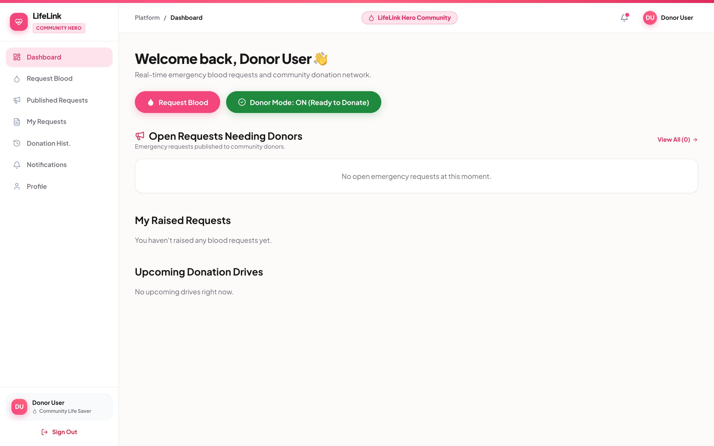
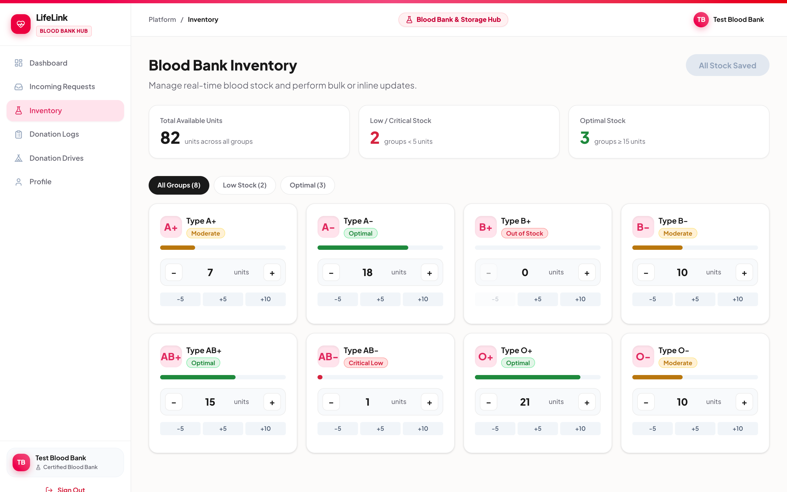
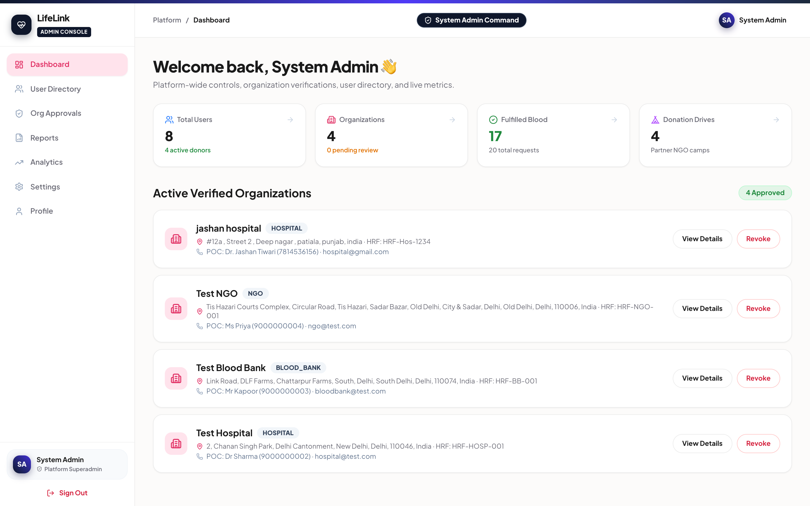
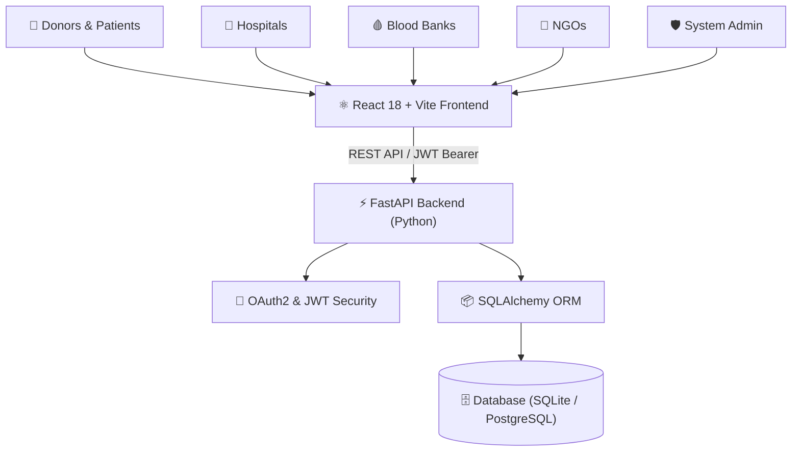

<div align="center">

# 🩸 LifeLink

### *Intelligent Blood Donation & Emergency Healthcare Coordination Platform*

[](https://fastapi.tiangolo.com)
[](https://reactjs.org)
[](https://vitejs.dev)
[](https://python.org)
[](LICENSE)

<p align="center">
  A modern, full-stack healthcare platform connecting blood donors, recipients, hospitals, blood banks, and NGOs to streamline emergency blood requests, real-time inventory management, and donation drives.
</p>

</div>

---

## 📸 Key Highlights & Screenshots

### 1. Modern Landing Page
> *Promotes blood donation awareness, live donation drives, metrics, and instant emergency requests.*


---

### 2. Donor & Patient Dashboard
> *Interactive blood compatibility matrix, active emergency alerts, and one-click donor availability toggle.*



---

### 3. Emergency Blood Request Portal
> *Fast, multi-step requisition system with hospital selection, required units, patient details, and urgency levels.*


---

### 4. Real-Time Blood Bank Inventory
> *Live component stock tracking across all blood groups (A+, A-, B+, B-, AB+, AB-, O+, O-) with supply-chain triage.*



---

### 5. Central Admin & Governance
> *Comprehensive oversight of all platform activity, institutional KYC verification, and user management.*



---

## 🌟 Core Features

- **👤 Donors & Patients:** Create emergency blood requests, track real-time fulfillment status, manage donation history, and toggle donor availability.
- **🏥 Hospitals:** Review and medically verify patient requests, order blood directly from linked blood banks, and confirm delivery.
- **🩸 Blood Banks:** Live component inventory management, incoming hospital requisition dispatch, and donation camp coordination.
- **🤝 NGOs:** Organize community blood donation camps, mobilize volunteers, and respond to critical local blood shortages.
- **🛡️ System Admin:** Verify and approve organization registrations (KYC), monitor platform analytics, and audit user activity.

---

## 🛠️ Architecture & Tech Stack



| Layer | Technologies |
|:---|:---|
| **Frontend** | React 18, Vite, React Router v6, Lucide React, Custom CSS Design System |
| **Backend** | Python 3.10+, FastAPI, Uvicorn, SQLAlchemy ORM, Pydantic v2 |
| **Security** | OAuth2 Password Bearer, JWT access tokens, bcrypt password hashing |
| **Database** | SQLite (development) / PostgreSQL (production-ready) with Alembic |

---

## ⚡ Quick Start

### 1. Clone the repository
```bash
git clone https://github.com/jashantiwari044/Life_link.git
cd Life_link
```

### 2. Backend Setup
```bash
# Create and activate virtual environment
python3 -m venv .venv
source .venv/bin/activate    # On Windows: .venv\Scripts\activate

# Install dependencies
pip install -r backend/requirements.txt

# Seed database
python reset_db.py

# Start FastAPI server
uvicorn backend.main:app --host 127.0.0.1 --port 8000 --reload
```
> 📍 Backend runs on: `http://localhost:8000`  
> 📖 Interactive API Docs: `http://localhost:8000/docs`

### 3. Frontend Setup
```bash
cd frontend
npm install
npm run dev
```
> 🌐 Frontend runs on: `http://localhost:5173`

---

## 🔑 Demo Test Credentials

All seed accounts use the default password: **`12345678`**

| Role | Email | Description |
|:---|:---|:---|
| 🛡️ **Admin** | `admin@test.com` | Institutional KYC approval & platform oversight |
| 👤 **Donor User** | `donor@test.com` | Active donor profile with history & active requests |
| 👤 **Regular User** | `user@test.com` | Standard recipient/patient account |
| 🏥 **Hospital** | `hospital@test.com` | Request verification & blood bank orders |
| 🩸 **Blood Bank** | `bloodbank@test.com` | Live inventory stock & camp organizer |
| 🤝 **NGO** | `ngo@test.com` | Donation drive publishing & volunteer responses |

---

<div align="center">

**LifeLink** — *Every drop counts. Every connection saves a life.* 🩸

</div>
