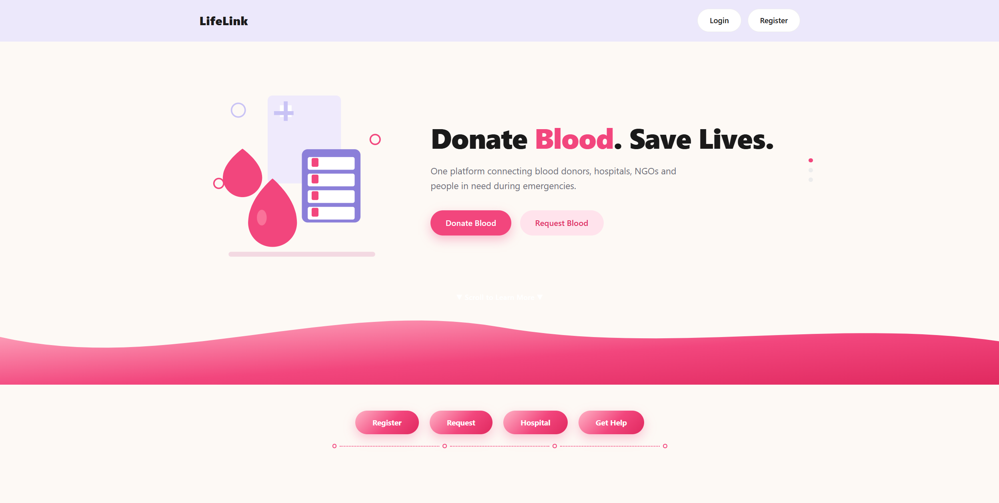
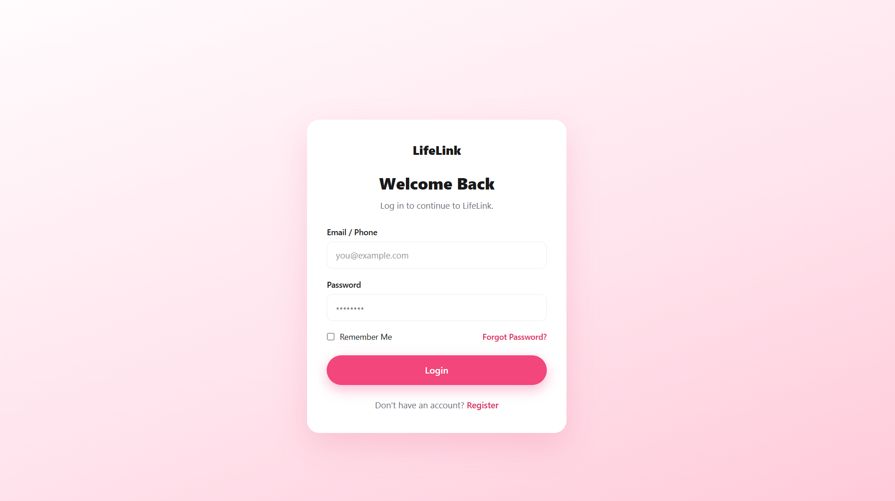
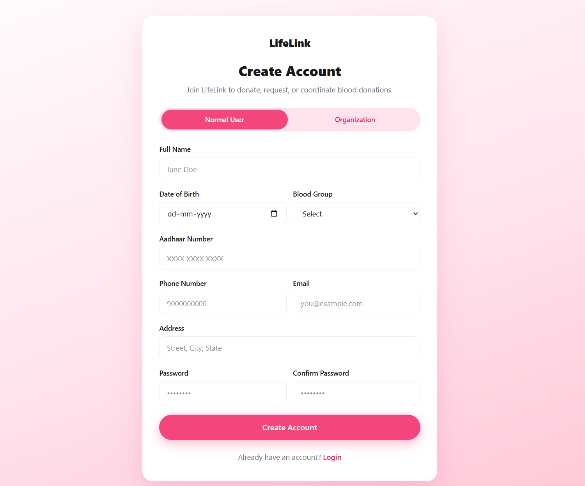
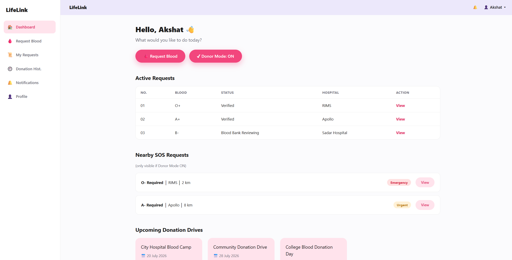
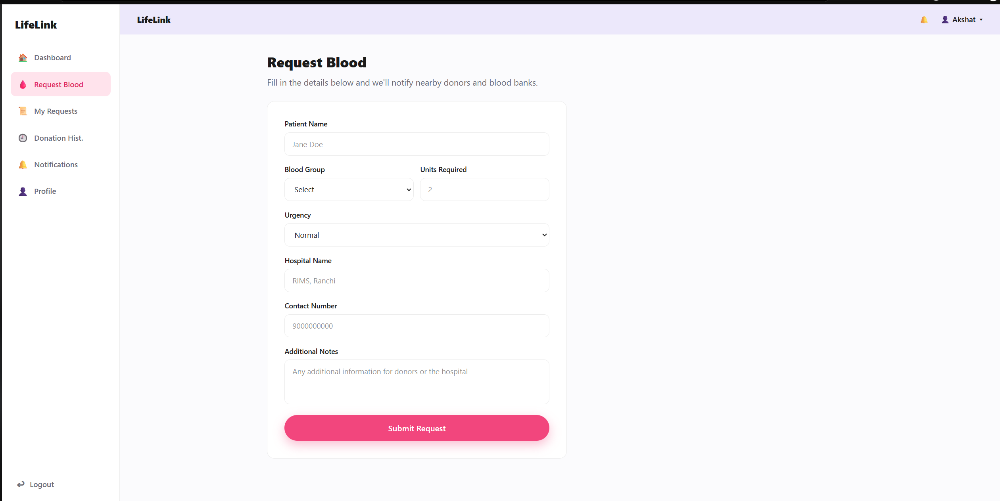
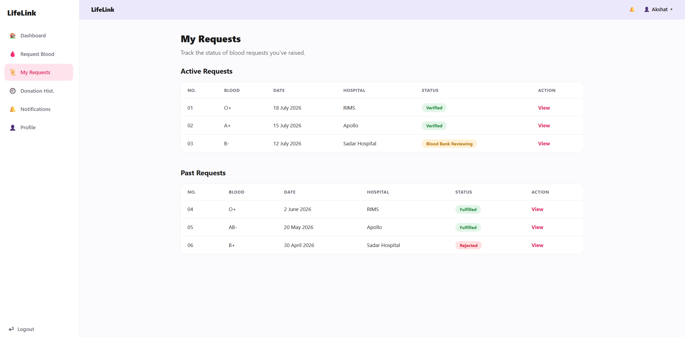
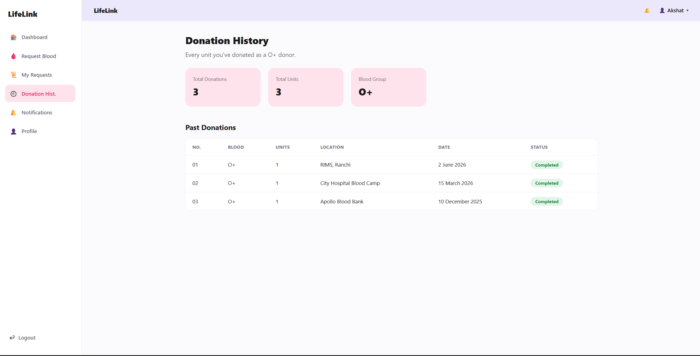
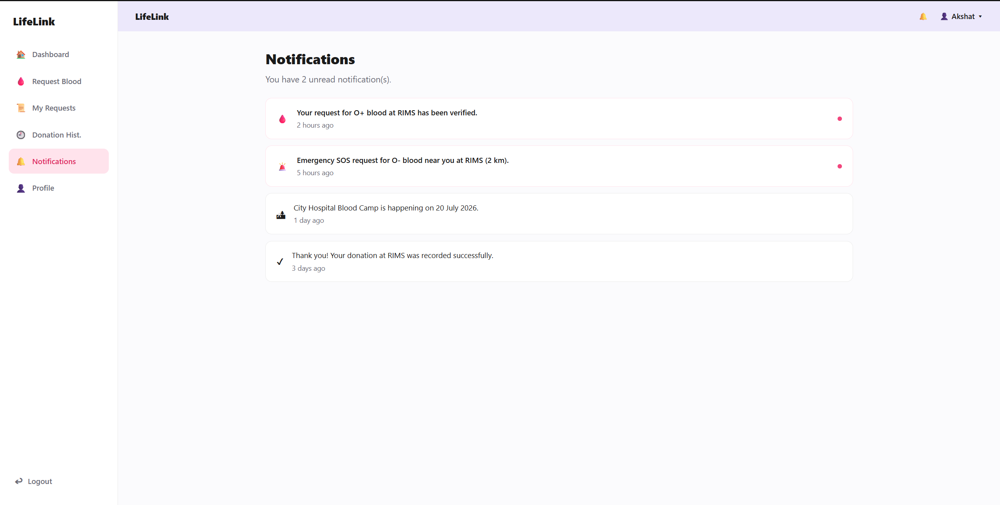
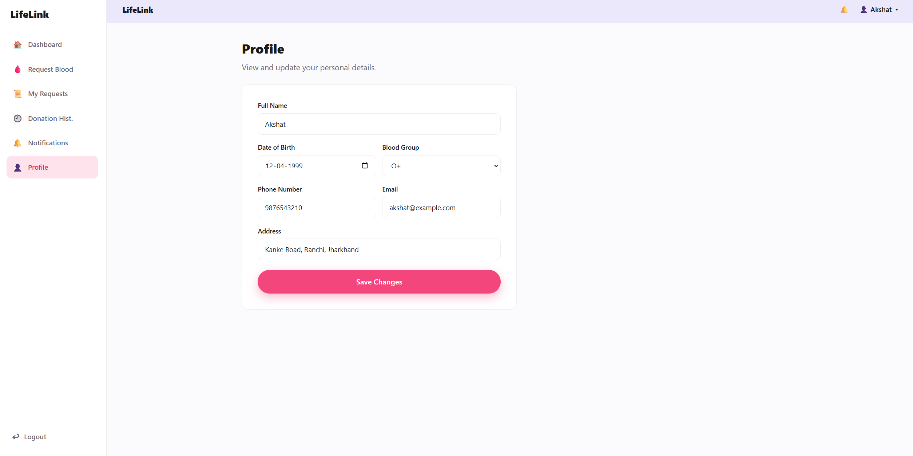

# LifeLink

LifeLink is a blood donation management platform developed using React and Vite. The application connects blood donors, recipients, hospitals, and organizations through a single platform, making it easier to request blood, donate blood, track requests, and receive important updates during emergencies.

## Project Overview

The system provides an easy-to-use interface for users to manage blood donation activities. It allows users to register, request blood, maintain their donation history, receive notifications, and update their personal information. The platform aims to simplify communication between donors and people in need while promoting timely blood donation.

---

## Features

- User registration and login
- Blood request submission
- Dashboard with active requests and donor mode
- Track current and previous blood requests
- View donation history
- Receive notifications and emergency alerts
- Manage user profile
- View upcoming blood donation drives

---

## Technologies Used

- React
- Vite
- JavaScript
- React Router
- CSS

---

## Project Structure

```
src/
├── assets/              # Images, icons, fonts, and other static resources
├── components/          # Reusable UI components shared across the application
├── config/              # Application configuration and routing setup
├── constants/           # Constant values and application-wide configurations
├── data/                # Static data, mock data, and sample datasets
├── pages/               # Individual application pages and screens
├── utils/               # Helper functions and utility methods
├── App.jsx              # Root application component
├── index.css            # Global styles
└── main.jsx             # Application entry point
```


---

## Getting Started

### Clone the repository

```bash
git clone https://github.com/your-username/lifelink.git
```

### Move to the project directory

```bash
cd lifelink
```

### Install dependencies

```bash
npm install
```

### Start the development server

```bash
npm run dev
```

### Build the project

```bash
npm run build
```

### Preview the production build

```bash
npm run preview
```

---

# Application Screenshots

## Home Page



The landing page introduces the platform and provides quick access to registration, login, blood donation, and blood request options.

---

## Login Page



Users can log in using their registered email or phone number. The page also includes Remember Me and Forgot Password options.

---

## Registration Page



New users can create an account by providing personal details. The platform supports registration for both individual users and organizations.

---

## Dashboard



The dashboard provides an overview of active blood requests, donor mode status, nearby emergency requests, and upcoming blood donation drives.

---

## Request Blood



Users can submit a blood request by entering patient details, blood group, hospital information, urgency level, and contact details.

---

## My Requests



This page allows users to monitor the status of active and previous blood requests.

---

## Donation History



Users can view their donation statistics along with records of previous blood donations.

---

## Notifications



The notification page displays updates related to blood requests, emergency alerts, donation confirmations, and upcoming blood donation camps.

---

## Profile



Users can update their personal information, contact details, blood group, and address from the profile page.

---

## Main Modules

- Authentication
- Dashboard
- Blood Request Management
- Donation History
- Notifications
- Profile Management

---

## Future Improvements

Some features that can be added in future versions include:

- Hospital management portal
- NGO management portal
- Blood bank integration
- Email and SMS notifications
- Location-based donor search
- Real-time request updates
- Admin dashboard

---

## License

This project was developed for academic and learning purposes.
